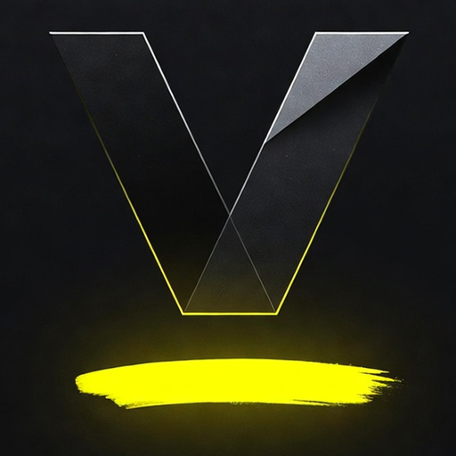
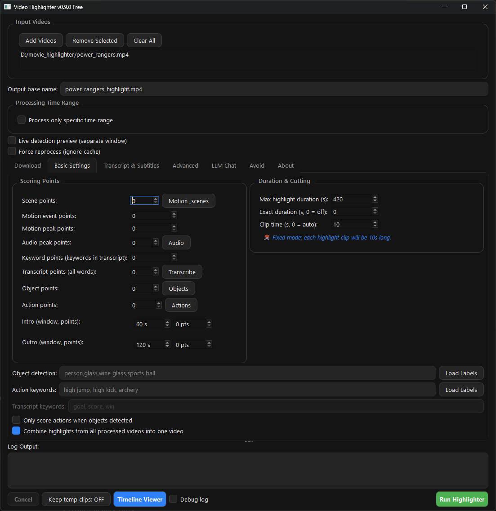
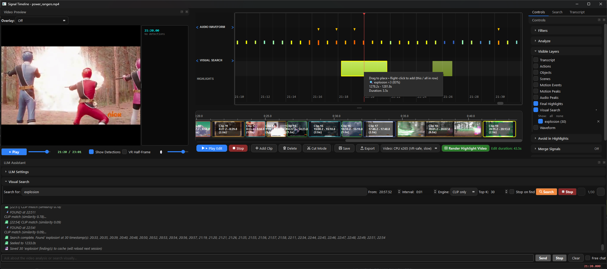
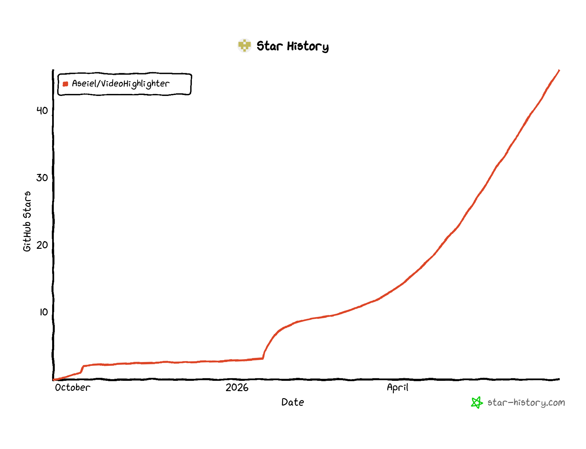

  

  

# VideoHighlighter

<!-- hy-mt2-i18n:start -->
[English](./README.md) | [中文](./README_zh-CN.md) | [日本語](./README_ja.md) | **Español**
<!-- hy-mt2-i18n:end -->

**Encuentra y explica los momentos que importan en grabaciones que no vas a subir a ningún sitio, y exporta el montaje en tu propio equipo.**

Una aplicación de escritorio local. Le das el vídeo en bruto; puntúa los momentos fuertes a partir de
la escena, el movimiento, el audio, los objetos, las acciones y la transcripción, te muestra *por qué*
puntuó cada uno en una línea de tiempo de señales y en un informe, y después exporta un vídeo de
resumen y los clips por separado. No se sube nada para el análisis, y el proceso básico no necesita
ninguna clave de API.

Libre y de código abierto (AGPL-3.0). Windows, macOS y Linux. GPU de Intel, AMD y NVIDIA.

**Idiomas de la interfaz** (About → Interface language): English, 简体中文, Español, Português
(Brasil), Français, 日本語, Deutsch, 한국어, Bahasa Indonesia, Türkçe, Italiano, Polski, Tiếng Việt,
Nederlands. Este README sigue siendo primero en inglés; las traducciones de arriba cubren
中文 / 日本語 / Español.

> **Es gratis.** Para no perderte las próximas versiones, pulsa el botón de motivación: la ⭐ de
> arriba de la página. Es el pago más barato que aceptamos.

## Para qué lo usa la gente

- **Un directo de 4 horas de Twitch o YouTube → unos minutos de lo mejor.** El ruido del público, tus
  propias reacciones y los cambios de escena puntúan, así que las partes intensas salen solas sin
  tener que recorrer el vídeo.
- **Una noche de cámaras de seguridad o de fototrampeo → los minutos en que algo se movió.**
  Detección de objetos más movimiento, sobre horas en las que no pasa nada, en local; algo que
  importa cuando lo grabado es tu propia casa.
- **Una tarjeta de GoPro o de dron → una película terminada.** La pestaña **Auto** encuentra la
  tarjeta, copia el material, corta los mejores momentos, monta el vídeo y pone la música al ritmo,
  todo como un único trabajo que se puede reanudar.
- **Un partido → los goles.** Escribe una regla para «balón dentro de la red» y puntuará ese evento
  según dónde están las cosas, en vez de esperar que un modelo de acciones lo distinga por cómo se ve
  la imagen.
- **Una entrevista, clase o pódcast largo → capítulos y subtítulos.** Transcripción local con
  Whisper, vídeo dividido en capítulos y traducción local opcional.
- **Revisión de cámara de coche o corporal → un relato que puedes entregar a otra persona.** El
  informe indica qué se midió, qué solo se dijo y qué no se pudo determinar.

¿No sabes qué detector encaja con tus grabaciones?
[docs/DETECTION-GUIDE.md](docs/DETECTION-GUIDE.md) explica para qué sirve cada uno y dónde falla.

## Qué lo hace diferente

**[Cada ejecución se explica a sí misma.](docs/REPORTS.md)** El informe es la aritmética detrás de
cada momento conservado: el desglose de puntos por señal, qué se activó, qué puntuó bien y aun así se
quedó fuera. Señala las afirmaciones que vienen de la transcripción y nunca se midieron, en lugar de
puntuarlas igualmente.
**[Abre uno real →](https://aseiel.github.io/VideoHighlighter-site/example-report.html)**

**[Reglas de composición.](docs/DETECTION-GUIDE.md#4-the-composition-engine)** Tú dices qué significa
una *combinación* de detecciones en tus grabaciones (una clase dentro de otra, contadas, mantenidas
durante un intervalo) y eso se convierte en un evento con el nombre que elijas. Como una regla vuelve
a leer detecciones que ya existen, editarla y volver a ejecutar cuesta milisegundos.

## Vista previa

**Visor de línea de tiempo**

**Demo**

https://github.com/user-attachments/assets/5c85af94-9228-4537-926a-1ed7a91fa5ee

## Instalación

Descarga una versión desde [Releases](https://github.com/Aseiel/VideoHighlighter/releases):

- **Windows**: ejecuta
  [`00-VideoHighlighter-Windows-Setup.exe`](https://github.com/Aseiel/VideoHighlighter/releases/latest/download/00-VideoHighlighter-Windows-Setup.exe).
  Se instala por usuario, sin permisos de administrador. Todavía no está firmado, así que pulsa
  *Más información → Ejecutar de todas formas*.
- **macOS**: arrastra el `.dmg` a Aplicaciones y quita una vez la marca de cuarentena:
  `xattr -dr com.apple.quarantine /Applications/VideoHighlighter.app`
  ([por qué](docs/INSTALL.md#macos)).
- **Linux / desde el código fuente**: `pip install -r requirements.txt && python main.py`. FFmpeg
  viene incluido.

Versiones portables, configuración de GPU, dónde escribe y cómo arreglar una interfaz demasiado
grande: **[docs/INSTALL.md](docs/INSTALL.md)**.

## Documentación

| | |
| --- | --- |
| [Elegir un detector](docs/DETECTION-GUIDE.md) | Objetos, acciones, búsqueda CLIP, reglas de composición: para qué sirve cada uno |
| [Por qué estos momentos](docs/REPORTS.md) | Qué contiene el informe y por qué está hecho así |
| [El proceso Auto](docs/AUTO-PIPELINE.md) | Tarjeta → importación → guion → música → vídeo, reanudable |
| [Instalación](docs/INSTALL.md) | Todas las plataformas, motores de GPU, ajustes |
| [Entrenar un modelo](docs/CUSTOM-MODEL-TRAINING.md) | Etiqueta tu propia clase y entrénala |
| [Modelos de la comunidad](docs/COMMUNITY-MODELS.md) | Instala modelos que otros entrenaron, publica los tuyos |
| [GPU Intel](docs/INTEL-GPU.md) · [GPU AMD](docs/AMD-GPU.md) · [GPU Apple](docs/MAC-GPU.md) | Aceleración según el fabricante |
| [ollama remoto](docs/OLLAMA-REMOTE.md) | Ejecuta el LLM local en otro equipo de tu red |

## Edición Pro

**VideoHighlighter (este repositorio) es software libre bajo AGPL-3.0, y lo seguirá siendo.**
Incluye análisis sin conexión, detección de caras en directo, reproducción VR en paralelo, búsqueda
CLIP, el motor de composición, entrenamiento de modelos (incluido enseñar a un modelo con un solo
recuadro dibujado en el reproductor, que luego sigue mejorando mientras la aplicación está inactiva)
y el centro de modelos.

**[VideoHighlighter Pro](https://aseiel.github.io/VideoHighlighter-site/)** es una edición de pago
aparte que añade trabajo en tiempo real: superposición de objetos y acciones en directo durante la
reproducción, enseñar una categoría en directo a mitad de la reproducción, búsqueda de «más como
esto», detección de vocabulario abierto y detección de contadores y marcadores.

La explicación no está entre ellas. El informe, los hallazgos y el asesor son idénticos en ambas
ediciones: una herramienta en la nube te da un botón y un resultado que no puedes cuestionar;
responder al «por qué», en local, es lo que esto hace en su lugar.

## Comunidad

VideoHighlighter a veces tiene opiniones sobre tus grabaciones. Cuando pase:
[únete al Discord](https://discord.gg/cUPJqPAMmm) y grita en #support, suelo estar por ahí. Los
errores y las ideas son bienvenidos en [Issues](https://github.com/Aseiel/VideoHighlighter/issues).

**Preguntas frecuentes.** [Lee las preguntas frecuentes](docs/FAQ/faq.md) para obtener ayuda con:
- Elegir detectores y ajustar la puntuación
- Consejos de rendimiento en CPU/GPU
- Solucionar problemas habituales

## Licencia

Copyright (C) 2026 Przemysław Kreft y Meric Donmezer.

Publicado bajo la GNU Affero General Public License v3.0: úsalo, modifícalo y distribúyelo
libremente, siempre que las versiones modificadas, incluidas las que se ofrecen a través de una red,
pongan a disposición su código fuente completo bajo la misma licencia. Texto completo en
[LICENSE](LICENSE); aviso en [COPYRIGHT](COPYRIGHT).

Los colaboradores conservan los derechos de autor de su propio trabajo; consulta
[CONTRIBUTING.md](CONTRIBUTING.md) y [CLA.md](CLA.md). Los titulares de los derechos también ofrecen
VideoHighlighter bajo una licencia comercial aparte.

## Contribuir

Consulta [CONTRIBUTING.md](CONTRIBUTING.md) para ver las pautas sobre calidad del código, pruebas y
qué hace buena una contribución. El proyecto agradece los informes de errores, las correcciones
pequeñas y las propuestas de funciones; revisa el CLA antes de tu primer PR.

